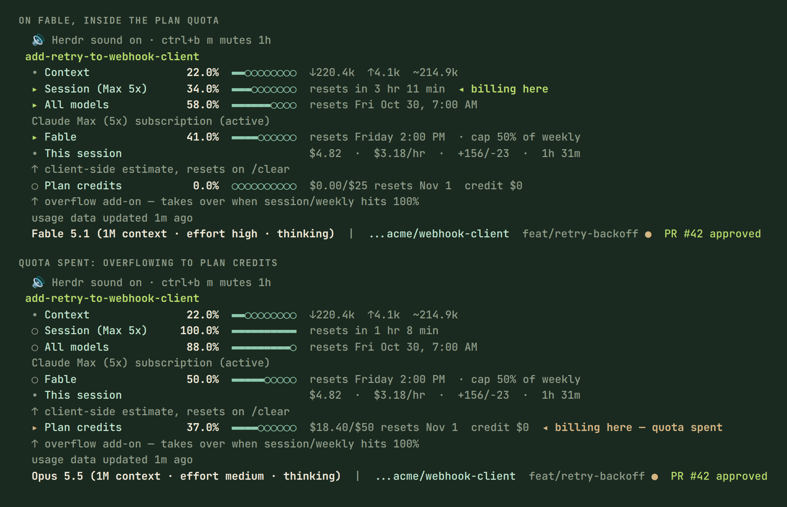

# claude-code-workstation

[](https://github.com/barnabys-drew/claude-code-workstation/actions/workflows/sast.yml)
[](https://github.com/barnabys-drew/claude-code-workstation/actions/workflows/deps.yml)
[](LICENSE)

The setup I use to run several [Claude Code](https://claude.com/claude-code)
agents side by side on Windows + WSL2: a statusline that always says **what is
paying for this session**, a Herdr + WezTerm terminal grid, one-key light/dark
theming, an orchestrator that keeps the panes moving through a shared GitHub
Project, and a Stream Deck that lights up when an agent needs me.



<sub>Synthetic data, rendered from the real script by
[`docs/screenshot/render.py`](docs/screenshot/render.py).</sub>

## What's inside

| | Piece | What it does |
|---|---|---|
| 📊 | [**Statusline**](docs/statusline.md) | Context, 5-hour and weekly limits, the Fable sub-cap, plan credits, session cost, git and PR state. A `▸` marks the one pool paying right now. |
| 🧩 | [**Herdr**](docs/herdr.md) | Multiplexer config for a grid of Claude panes: named sidebar rows, a sound and toast when an agent finishes, one-key mute for an hour, jump-to-pane-N. |
| 🖥️ | [**WezTerm + theme**](docs/terminal-and-theme.md) | Pine-dark and bone-paper-light palettes, Windows-style clipboard, and `term-theme` to flip WezTerm, Windows Terminal and Claude Code together. |
| 🪄 | [**Skills**](docs/skills.md) | `/regrid` re-tiles panes into a tidy grid; `/dark` and `/light` switch the theme. |
| 🤖 | [**Orchestrator**](docs/orchestrator.md) | Works a GitHub Project of tasks across your repos: starts a Claude pane per item, keeps it moving, and only brings you in for decisions, which you answer on the issue. |
| 🎛️ | [**Stream Deck**](streamdeck/README.md) | A "Claude needs you" key that flashes for blocked agents and jumps to them, plus theme, media, screenshot and services keys. |

Each piece stands alone. Take only the statusline if that's all you want.

## Quick start: just the statusline

```bash
git clone https://github.com/barnabys-drew/claude-code-workstation
cp claude-code-workstation/statusline/statusline-command.sh ~/.claude/
```

Then in `~/.claude/settings.json`:

```json
{
  "statusLine": {
    "type": "command",
    "command": "STATUSLINE_ROWS=context,session,weekly,cost bash ~/.claude/statusline-command.sh"
  }
}
```

That runs on the hook payload alone: no browser, no cron. The Fable and
plan-credit rows need the optional scraper; see
[docs/statusline.md](docs/statusline.md#the-scraper-optional).

## Requirements

| Piece | Needs |
|---|---|
| Statusline core | bash, python3, git |
| Usage scraper | Chrome on the Windows side of WSL2, cron. Stdlib Python only. |
| Orchestrator | Herdr, `gh` with the `project` scope |
| Herdr, theme, skills | WSL2 Ubuntu, [Herdr](https://github.com/herdrdev/herdr), WezTerm on Windows |
| Stream Deck | Windows, Stream Deck 7.1+, Node 24 |

The statusline core is portable. Everything else is built for, and only tested
on, WSL2 with the GUI apps on the Windows side.

## Layout

```
statusline/   statusline-command.sh, scraper, Chrome helpers   -> ~/.claude/
herdr/        config.toml, bin/ (mute, focus-pane, sound)       -> ~/.config/herdr/, ~/.local/bin/
wezterm/      wezterm.lua                                       -> %USERPROFILE%\.wezterm.lua
theme/        term-theme, paper.json                            -> ~/.claude/scripts/, ~/.claude/themes/
skills/       regrid, dark, light, orchestrate                  -> ~/.claude/skills/
orchestrator/ board, dispatcher, watcher, setup.sh              -> linked as ~/.claude/workboard
streamdeck/   Stream Deck plugin (TypeScript)                   -> npm run install-plugin
config/       example settings.json hooks and crontab
docs/         per-piece docs and the screenshot renderer
```

Examples use `/home/YOU`; substitute your own home directory.

## License

[MIT](LICENSE)
